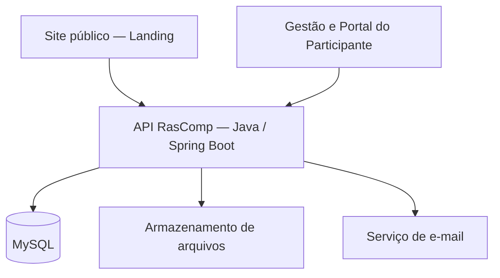

<div align="center">
  

  # RasComp

  **Plataforma de gestão e acompanhamento de competições de robótica**

  Desenvolvida no contexto da **IEEE Robotics & Automation Society — UFRB**.

  [🌐 Site institucional](https://rasufrb.site) · [🔐 Acessar plataforma](https://app.rasufrb.site) · [🎨 Repositório frontend](https://github.com/gbsalermo/Rascomp-FRONT)

  
  
  
  
</div>

---

## O projeto

O **RasComp** centraliza o ciclo de uma competição de robótica: da criação do evento e inscrição de participantes à operação das provas e divulgação dos resultados.

A proposta é oferecer um ambiente integrado para **organização, competidores e público**, reduzindo a dependência de formulários avulsos, planilhas e processos manuais.

### Como funciona

```text
Organização cria a competição e suas categorias
                     ↓
Participantes formam equipes e realizam inscrições
                     ↓
Gestão analisa e aprova as inscrições
                     ↓
Organização acompanha e opera as modalidades
                     ↓
Resultados, rankings e chaves são disponibilizados
```

## Principais recursos

| Área | O que a plataforma oferece |
|---|---|
| **Competições** | Cadastro de edições, categorias e períodos de inscrição |
| **Participantes e equipes** | Contas, vínculos, responsáveis e robôs |
| **Inscrições** | Solicitações, comprovantes e análise pela organização |
| **Follow Line** | Registro de tomadas e tentativas, tempos e classificação |
| **Sumô / Mini Sumô** | Inspeção, partidas, rounds, chaveamento e resultados |
| **Acompanhamento público** | Consulta de informações, participantes, rankings e resultados |
| **Controle de acesso** | Interfaces e permissões específicas para organização e participantes |

### Uma plataforma para diferentes públicos

**Organização:** configura as competições, acompanha inscrições e conduz as provas.

**Participantes:** utilizam o portal para suas equipes, robôs, inscrições e acompanhamento competitivo.

**Público:** acompanha a competição pelas páginas públicas, conforme as informações disponibilizadas pela organização.

## Arquitetura em uma visão

O RasComp conecta os ambientes público e autenticado a uma única API, responsável pelas regras competitivas, permissões e persistência.



A organização registra e acompanha provas pela Gestão; participantes interagem pelo Portal; a Landing apresenta os dados públicos da mesma competição.

## Estágio atual

**MVP V1 em operação (outubro de 2026).** O RasComp entrou em uso para a primeira competição, com inscrição de participantes e equipes, cadastros de robôs, comprovantes e análise da Gestão. A V1 inclui **inscrição de Futebol de Robôs sem exigir robô próprio**, com fluxo distinto do Sumô e Follow Line, e biblioteca de documentos **Regras e Ajuda**. A operação completa das partidas de Futebol permanece como evolução futura.

A Galeria completa e sua administração estão temporariamente suspensas, mantendo-se a prévia institucional na Landing e a edição de imagens de suas seções. A nova Galeria de fotos/vídeos fica para a **V2.0, depois da competição**.

As próximas prioridades são estabilidade operacional, resolução de bugs, configuração de backup local e recuperação verificável. O sistema estar em produção não significa que carga, restauração ou contingência tenham sido integralmente homologadas.

## Tecnologias principais

Java 21 · Spring Boot · Spring Security · MySQL · Flyway · JPA/Hibernate · OpenAPI · JUnit

Este repositório contém o **backend e as regras de negócio**. As interfaces web ficam no [RasComp-FRONT](https://github.com/gbsalermo/Rascomp-FRONT).

## Conheça o RasComp

- **Site da IEEE RAS UFRB:** https://rasufrb.site
- **Plataforma de acesso:** https://app.rasufrb.site
- **Interfaces do projeto:** [RasComp-FRONT](https://github.com/gbsalermo/Rascomp-FRONT)

---

<div align="center">
  <sub>RasComp · Robótica, organização e acompanhamento competitivo · IEEE RAS UFRB</sub>
</div>
